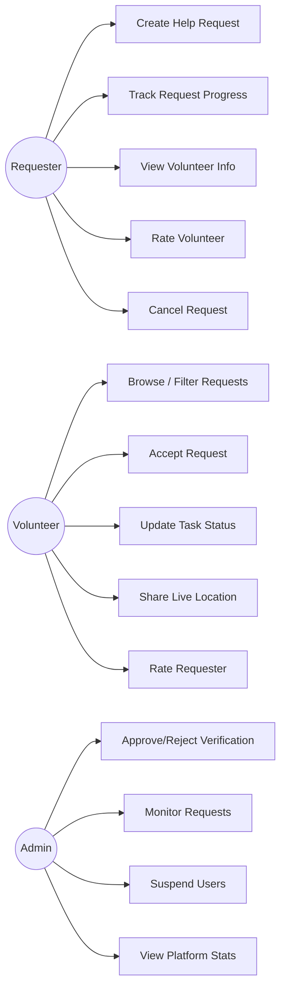
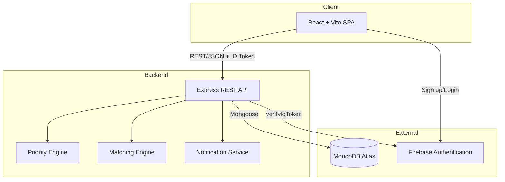
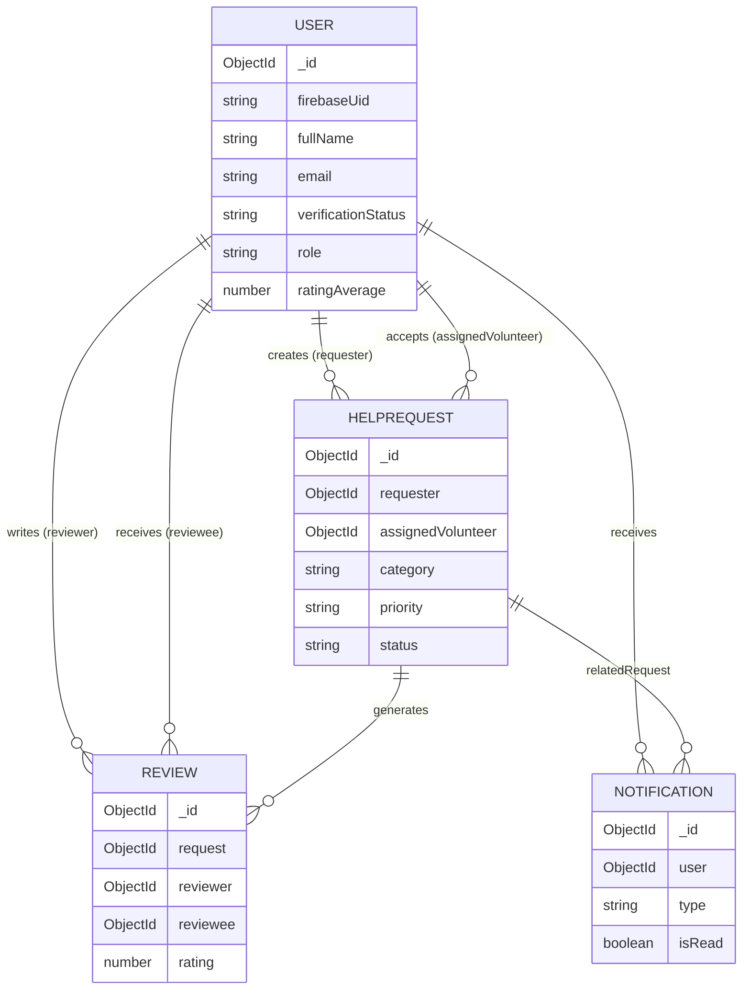
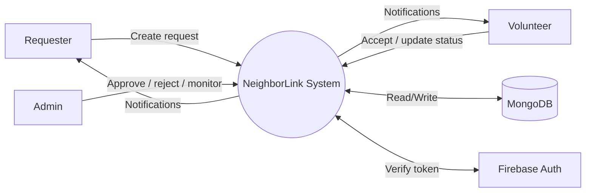

# Diagrams (Mermaid source)

## Use Case Diagram


## System Architecture Diagram


## Request Workflow (State Diagram)
```mermaid
stateDiagram-v2
  [*] --> Pending: Request created
  Pending --> Accepted: Volunteer accepts
  Pending --> Cancelled: Requester cancels
  Accepted --> "On the Way": Volunteer updates
  Accepted --> Cancelled
  "On the Way" --> "In Progress": Volunteer updates
  "On the Way" --> Cancelled
  "In Progress" --> Completed: Volunteer marks done
  "In Progress" --> Cancelled
  Completed --> [*]
  Cancelled --> [*]
```

## ER Diagram


## DFD Level 0

